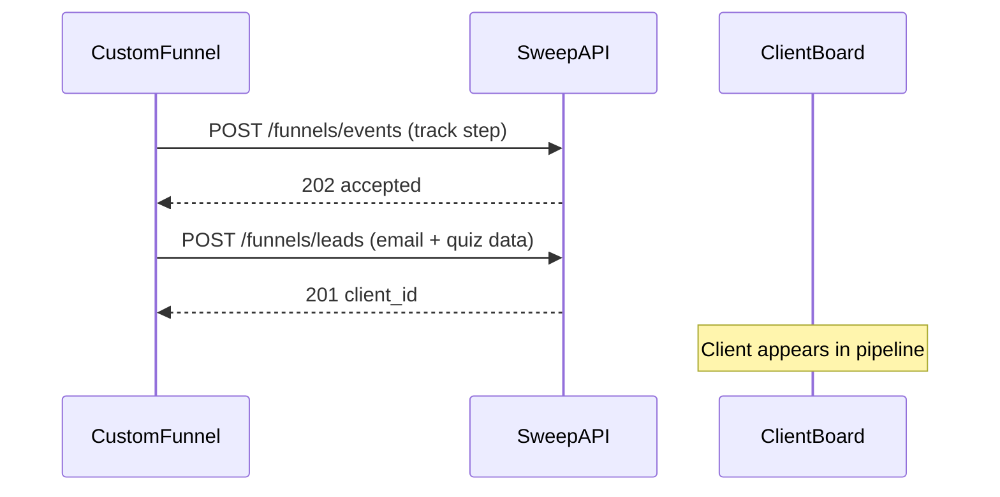
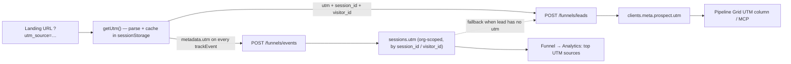

# Sweep OS Funnel Integration Guide (Master)

**Single source of truth for integrating custom-built funnels with Sweep OS.** Share this document with an LLM or developer to wire event tracking and lead capture from any site, quiz, or checkout you control.

---

## Table of Contents

1. [For LLM implementers (start here)](#for-llm-implementers-start-here)
2. [Overview](#overview)
3. [Custom funnel integration playbook](#custom-funnel-integration-playbook)
4. [API reference](#api-reference)
5. [Event ingestion](#event-ingestion)
6. [UTM tracking](#utm-tracking)
7. [Lead capture (Client Board)](#lead-capture-client-board) — matching, [channel tagging](#channel-tagging-attribution), [form metadata](#form-metadata-meta-prospect), [staged/partial submits](#staged-partial-submits), Meta Pixel/CAPI
8. [Implementation examples](#implementation-examples) — TypeScript module, vanilla JS, [video play/watch-time tracking](#video-play--watch-time-tracking), cURL
9. [Best practices](#best-practices)
10. [Testing & troubleshooting](#testing--troubleshooting)
11. [Authenticated endpoints (dashboard only)](#authenticated-endpoints-dashboard-only)
12. [Generic webhook intake (GHL / Zapier-style, field-mapped)](#generic-webhook-intake-ghl--zapier-style-field-mapped) — a **third, separate** endpoint; different UTM contract than the two above

---

## For LLM implementers (start here)

Use this checklist when building or editing funnel tracking code. Do **not** invent auth headers, GraphQL, or WebSockets — only the two public REST endpoints below exist for a funnel you control end-to-end.

> **Not building a custom funnel from scratch — wiring GHL, Zapier, Make, or some other third-party form/survey tool instead?** Stop here and use [Generic webhook intake](#generic-webhook-intake-ghl--zapier-style-field-mapped) at the bottom of this doc instead. It's a **different endpoint** (`POST /webhooks/funnels/{token}`, not `/funnels/events` or `/funnels/leads`), with a **different UTM shape** (flat `utm_source`/`utm_medium`/… keys, not a nested `utm: {...}` object). Sending the nested shape to that endpoint silently drops UTM into `opt_in_data` instead of being recognized — no error, no warning.

### Inputs you need from the human

| Input | Where to get it |
|-------|-----------------|
| `API_BASE_URL` | Sweep backend URL, e.g. `https://api.sweepai.site` or `http://localhost:8000` |
| `FUNNEL_ID` | Sweep OS → Funnels → funnel → **Overview** tab (UUID) |
| Step `event_name` values | Funnels → **Steps** tab — strings must match **exactly** (case-sensitive) |

### What to implement

1. **Identity + attribution helpers** (browser only)
   - `visitor_id` → `localStorage` (stable across visits)
   - `session_id` → `sessionStorage` (new per tab/session)
   - `utm` → parse `utm_*` from the landing URL, cache in `sessionStorage`, send as `metadata.utm` with **unprefixed** keys (see [UTM tracking](#utm-tracking))

2. **`trackEvent(eventName, metadata?, idempotencyKey?)`**
   - `POST {API_BASE_URL}/funnels/events`
   - `Content-Type: application/json`
   - No `Authorization` header
   - Fire-and-forget: never block UI on failure; log errors only

3. **`submitLead(payload)`** (when the user completes a form/quiz)
   - `POST {API_BASE_URL}/funnels/leads`
   - Same headers; no auth
   - Call **after** you have at least one of: `email`, `name`, `first_name`/`last_name`, `phone`, `instagram`
   - Always send `session_id` + `visitor_id` (same values as `trackEvent`) so Sweep OS can attach the session's UTM
   - Put form answers in `quiz_answers` (qualification questions) or `opt_in_data` (consent/preferences) as a **flat** object keyed by human-readable question labels — these render verbatim in the Leads tab and Pipeline Grid **Answers** column

4. **Step mapping**
   - Every funnel step in Sweep OS has an `event_name`. Your custom funnel must call `trackEvent` with that exact string when the user hits that step (page view, quiz screen, submit, payment, etc.).

5. **Idempotency** (recommended for all retried actions)
   - Include `idempotency_key` on `POST /funnels/events` when the client might retry (form submit, payment, webhook replay).
   - First request → `202`, `"status": "accepted"`.
   - Same key again (same org) → `202`, `"status": "duplicate"` (no new row).
   - Keys are scoped to the **organization** (derived from `funnel_id`), not per funnel — prefix keys: `{funnel_id}_{event}_{unique_id}`.

### Minimal happy-path sequence (quiz funnel)

```text
1. User lands        → trackEvent('quiz_page_view', { page_id: 'intro' })
2. User starts quiz  → trackEvent('quiz_start', { form_id: 'root-quiz' })
3. User submits form → trackEvent('form_submit', { form_id: 'root-quiz' }, 'form_submit_{sessionId}_{formId}')
4. Same moment       → submitLead({ funnel_id, session_id, visitor_id, email, name, quiz_answers, source: 'quiz', funnel_step_reached: 'form_submit' })
```

### Do not

- Omit `funnel_id` on either endpoint (400 on events, 422 on leads).
- Guess `event_name` strings — they must match Sweep funnel steps.
- Use `idempotency_key` on `/funnels/leads` (not supported; leads are deduped server-side by `email`, then `phone`, and repeat/partial captures for the same `funnel_id` are deduped automatically — see [Staged / partial submits](#staged-partial-submits)).
- Send nested objects/arrays as answer values when a string will do — they show as raw JSON in the Answers column.
- Use `utm_`-prefixed keys inside **event** `metadata.utm` — funnel analytics only reads `utm.source` (unprefixed). The lead endpoint accepts either form.
- Try to set the lead's channel/tag yourself — Sweep OS tags funnel leads automatically (see [Channel tagging](#channel-tagging-attribution)).
- Block navigation or payment on tracking errors.

### Verify

```bash
# Event (with idempotency — should be 202 accepted)
curl -sS -X POST "${API_BASE_URL}/funnels/events" \
  -H "Content-Type: application/json" \
  -d '{"funnel_id":"YOUR_FUNNEL_UUID","event_name":"form_submit","visitor_id":"v1","session_id":"s1","metadata":{"form_id":"root-quiz"},"idempotency_key":"test_key_001"}'

# Repeat same idempotency_key — should be 202 duplicate
curl -sS -X POST "${API_BASE_URL}/funnels/events" \
  -H "Content-Type: application/json" \
  -d '{"funnel_id":"YOUR_FUNNEL_UUID","event_name":"form_submit","visitor_id":"v2","session_id":"s2","metadata":{"form_id":"root-quiz"},"idempotency_key":"test_key_001"}'
```

---

## Overview

Sweep OS tracks funnel events and leads via REST APIs. Both public ingestion endpoints are **unauthenticated**. The server resolves `org_id` from `funnel_id`.

| Endpoint | Method | Purpose |
|----------|--------|---------|
| `/funnels/events` | `POST` | Track user actions (page views, quiz steps, form submits, payments) |
| `/funnels/leads` | `POST` | Create or update a client on the Client Board |

**Base URL:** `{API_BASE_URL}` with **no** `/api` prefix unless your deployment adds one. Production example: `https://api.sweepai.site`.

**Router mount:** `backend/app/main.py` → `app.include_router(funnels.router, prefix="/funnels")`.



**Key concepts:**

- **Funnel** — Logical sequence configured in Sweep OS (name, optional domain/slug).
- **Funnel step** — Row in Steps tab; `event_name` is what you send in `POST /funnels/events`.
- **Event** — One tracked action; stored with `visitor_id`, `session_id`, optional `metadata`.
- **Session** — Server-side row keyed by `session_id`/`visitor_id`; holds the `utm` and first `referrer` seen in event metadata. Powers analytics source breakdowns and lead UTM lookup.
- **Lead** — Client record created/updated via `POST /funnels/leads`. Tagged `source_channel: "paid"` + `source_funnel_id` on creation, with form data under `client.meta.prospect`.

---

## Custom funnel integration playbook

### Phase 1 — Configure Sweep OS (human / dashboard)

1. Funnels → **+ New Funnel** → name, optional domain/slug/environment.
2. **Steps** tab — add one row per trackable step, e.g.:
   - `quiz_page_view` — user sees a quiz screen
   - `quiz_start` — user begins the quiz
   - `form_submit` — user submits contact/qualification form
   - `payment_succeeded` — checkout completed
3. Copy **Funnel ID** from Overview.

### Phase 2 — Map your UI to `event_name`

Build a table in your funnel repo (or env config):

| Your screen / action | Sweep `event_name` | Idempotent? |
|----------------------|-------------------|-------------|
| Landing page load | `page_view` or `quiz_page_view` | No |
| Quiz step N | `quiz_step_{n}` or shared `quiz_page_view` + `metadata.step` | No |
| Form submit | `form_submit` | **Yes** — use `idempotency_key` |
| Stripe success | `payment_succeeded` | **Yes** — use payment intent / txn id |

### Phase 3 — Shared client module

Implement one module (TypeScript or vanilla JS) that exports:

- `getVisitorId()` / `getSessionId()` / `getUtm()`
- `trackEvent(name, metadata?, idempotencyKey?)`
- `submitLead(fields)`

Use env vars:

```bash
NEXT_PUBLIC_API_BASE_URL=https://api.sweepai.site
NEXT_PUBLIC_FUNNEL_ID=ee46f8a6-ace5-4dd1-9279-abf58ae6ae9c
```

### Phase 4 — Wire each screen

- **SPA / Next.js:** call `trackEvent` in `useEffect` on route change or on button handlers.
- **Static HTML:** inline script on `load` / form `submit`.
- **Server-side form handler:** optionally call `/funnels/events` from the server (no CORS issue); still use `idempotency_key` for submits.

### Phase 5 — Lead handoff to pipeline

On successful form/quiz completion:

1. `trackEvent('form_submit', { form_id, ... }, idempotencyKey)` — analytics + funnel health.
2. `submitLead({ funnel_id, session_id, visitor_id, email, name, phone, quiz_answers, source: 'quiz', funnel_step_reached: 'form_submit' })` — creates/updates Client Board row.

New clients are created with `lifecycle_state: "qualified"` and tagged as paid leads of this funnel (see [Lead capture](#lead-capture-client-board)).

### Phase 6 — Payments (if applicable)

```typescript
await trackEvent(
  'payment_succeeded',
  {
    amount_cents: 5000,
    currency: 'usd',
    transaction_id: 'pi_abc123',
  },
  `payment_pi_abc123` // idempotency_key — stable per charge
);
```

---

## API reference

### POST /funnels/events

Ingest a funnel event. **Public.** Org resolved from `funnel_id`.

**Request body (JSON):**

| Field | Type | Required | Description |
|-------|------|----------|-------------|
| `funnel_id` | UUID string | Yes | From funnel Overview |
| `event_name` | string (1–100) | Yes | Must match a funnel step exactly |
| `visitor_id` | string | Recommended | Stable per browser |
| `session_id` | string | Recommended | Per visit/tab |
| `client_id` | UUID string | No | Link to existing client (same org) |
| `metadata` | object | No | Arbitrary JSON: `page_url`, `form_id`, `utm`, `amount_cents`, etc. |
| `event_timestamp` | ISO 8601 | No | Client time; defaults to server `now` |
| `idempotency_key` | string | No | Dedupes retries within the org (see [Idempotency](#idempotency)) |

**Example — form submit with idempotency:**

```json
{
  "funnel_id": "ee46f8a6-ace5-4dd1-9279-abf58ae6ae9c",
  "event_name": "form_submit",
  "visitor_id": "visitor_abc",
  "session_id": "session_xyz",
  "metadata": {
    "form_id": "root-quiz",
    "page_url": "https://example.com/quiz",
    "page_title": "Tailoring Quiz"
  },
  "idempotency_key": "form_submit_session_xyz_root-quiz"
}
```

**Responses (always HTTP 202 on success path):**

```json
{ "event_id": "82c9029e-4b0b-4ab1-abad-0dd41f6be3ad", "status": "accepted" }
```

```json
{ "event_id": "82c9029e-4b0b-4ab1-abad-0dd41f6be3ad", "status": "duplicate" }
```

| HTTP | Meaning |
|------|---------|
| 202 | Event accepted or duplicate (check `status`) |
| 400 | Missing `funnel_id` |
| 404 | Funnel or `client_id` not found |
| 422 | Schema validation (bad UUID, `event_name` empty or > 100 chars, `metadata` not an object) |
| 500 | Server error — the payload is logged to `event_errors` and counted in Funnel → Health |

**Implementation notes:**

- `idempotency_key` is stored inside `event_metadata` on the server. Duplicate detection uses org-scoped JSON containment (PostgreSQL `jsonb` cast). Safe to use on **any** event type, not only payments.
- Each event upserts a **session** (matched by `session_id` or `visitor_id`, org-scoped). `metadata.utm` overwrites the session's UTM every time it is present; `metadata.referrer` is kept from the first event only. Send `utm` on the landing event at minimum.

---

### POST /funnels/leads

Create or update a client on the Client Board. **Public.** Org resolved from `funnel_id`.

**Request body (JSON):**

| Field | Type | Required | Description |
|-------|------|----------|-------------|
| `funnel_id` | UUID string | Yes | From funnel Overview |
| `email` | string | Conditional | Used to match existing client |
| `name` | string | Conditional | Full name; split if `first_name`/`last_name` omitted |
| `first_name` | string | Conditional | |
| `last_name` | string | Conditional | |
| `phone` | string | Conditional | |
| `instagram` | string | Conditional | e.g. `@username` |
| `notes` | string | No | Stored on create; appended (blank line separated) when updating |
| `source` | string | No | Form type, e.g. `quiz`, `opt_in`, `form`. Shown as Source on the Leads tab. **Not** the attribution channel |
| `quiz_answers` | object | No | Form/quiz answers → `client.meta.prospect.quiz_answers`. See [Form metadata](#form-metadata-meta-prospect) |
| `opt_in_data` | object | No | Consent/preferences → `client.meta.prospect.opt_in_data` |
| `funnel_step_reached` | string | No | Last step `event_name` at capture time |
| `utm` | object | No | `{ source, medium, campaign, term, content }` or `utm_`-prefixed keys. Other keys are dropped; values trimmed to 200 chars |
| `session_id` / `visitor_id` | string (≤ 200) | Recommended | Same ids sent with `trackEvent`. When `utm` is omitted/empty, Sweep OS copies UTM from that tracked session (by `session_id`, then `visitor_id`) |

**Validation:**

- At least one of `email`, `name`, `first_name`/`last_name`, `phone`, or `instagram` when **creating** a new client (400).
- Combined `quiz_answers` + `opt_in_data` JSON must be ≤ **50,000 bytes** (422).
- Unknown top-level fields are ignored — put custom data inside `quiz_answers` / `opt_in_data`, not at the root.

**Response (201):**

```json
{ "client_id": "uuid", "created": true, "message": "Client created" }
```

```json
{ "client_id": "uuid", "created": false, "message": "Client updated" }
```

| HTTP | Meaning |
|------|---------|
| 201 | Client created or updated (check `created`) |
| 400 | No contact fields on a new client |
| 404 | Funnel not found |
| 422 | Schema validation (missing/bad `funnel_id`, prospect payload > 50 KB, wrong types) |

---

## Event ingestion

### Metadata recommendations

```json
{
  "page_url": "https://example.com/current-page",
  "page_title": "Page Title",
  "form_id": "root-quiz",
  "utm": { "source": "google", "medium": "cpc", "campaign": "summer" },
  "referrer": "https://google.com"
}
```

For payments, also include: `amount_cents`, `currency`, `transaction_id`. `amount_cents` is summed into analytics revenue.

**UTM in event metadata:** use the unprefixed keys (`source`, `medium`, `campaign`, `term`, `content`) under `metadata.utm`. Analytics' "top UTM sources" reads `utm.source` only, so `utm_source` there is invisible. Parse them from the landing URL once and resend them on every event of the session, or at least on the first one:

```typescript
function readUtm(): Record<string, string> | undefined {
  const q = new URLSearchParams(window.location.search);
  const out: Record<string, string> = {};
  for (const k of ['source', 'medium', 'campaign', 'term', 'content']) {
    const v = q.get(`utm_${k}`);
    if (v) out[k] = v;
  }
  return Object.keys(out).length ? out : undefined;
}
```

### Idempotency

**When to use:** Any action that may be retried — `form_submit`, `payment_succeeded`, webhook-driven events, double-click submits.

**Key format (recommended):**

```text
{event_name}_{stable_unique_id}
```

Examples:

- `form_submit_session_abc_root-quiz`
- `payment_pi_3NxYz...`
- `quiz_complete_visitor_abc_2026-06-05`

**Behavior:**

1. First `POST` with a new key → `202`, `status: "accepted"`, new `event_id`.
2. Second `POST` with the same key (same org) → `202`, `status: "duplicate"`, **same** `event_id`, no new event row.
3. Keys are **org-wide** (all funnels in the org share one idempotency namespace). Prefix with funnel or form id to avoid collisions.

**Without `idempotency_key`:** each request creates a new event (fine for page views).

---

## UTM tracking

UTM drives three things in Sweep OS: funnel analytics "top UTM sources", the Pipeline Grid UTM column, and the Funnels dashboard source breakdown. It flows like this:



### What to send

| Where | Shape | Notes |
|-------|-------|-------|
| `POST /funnels/events` → `metadata.utm` | `{ source, medium, campaign, term, content }` | **Unprefixed keys only.** Analytics reads `utm.source`; `utm_source` is stored but never counted. Send on at least the first event of the session; resending on every event is safest. |
| `POST /funnels/leads` → `utm` | Same keys, or `utm_`-prefixed | Normalized server-side to the 5 standard keys, values trimmed to 200 chars, everything else dropped. |
| `POST /funnels/leads` → `session_id`, `visitor_id` | Same ids as `trackEvent` | Used to look up the session's UTM when `utm` is omitted or empty (session match first, then visitor, most recent). |
| `metadata.referrer` | `document.referrer` | Stored on the session from the **first** event only; powers "top referrers". |

### Server behaviour

- Each event with `metadata.utm` **overwrites** the session's stored UTM. An event without `utm` leaves it untouched — so never send `utm: {}` or `utm: null` on later pages if you want to keep the landing values (an absent/`undefined` key is fine; `JSON.stringify` drops it).
- Lead UTM precedence: explicit `utm` on the lead payload → session UTM by `session_id` → session UTM by `visitor_id` → previous `meta.prospect.utm` kept.
- Lead UTM is displayed only for clients tagged `paid` (i.e. funnel leads — see [Channel tagging](#channel-tagging-attribution)).

### Checklist

1. Ad / link URLs carry `utm_source`, `utm_medium`, `utm_campaign` (+ optional `utm_term`, `utm_content`). For Meta ads use URL parameters such as `utm_source=facebook&utm_medium=paid&utm_campaign={{campaign.name}}&utm_content={{ad.name}}`.
2. Funnel parses them on the landing page **before** any redirect or client-side route change strips the query string, and caches them in `sessionStorage` (see `getUtm()` in the [TypeScript module](#typescript-module-copy-paste-for-custom-funnels)).
3. Multi-domain funnels (e.g. landing on one domain, quiz on another): forward the `utm_*` params in the link to the next domain, or the second domain starts a session without them.
4. Verify: `GET /funnels/events?funnel_id=…` (dashboard) shows `utm` per event's session; submit a test lead and check the Pipeline Grid UTM column.

---

## Lead capture (Client Board)

- **Endpoint:** `POST /funnels/leads`
- **Auth:** None

### Matching and merge rules

1. **Dedupe:** existing client (same org) matched by `email` first, then by `phone` (digits-normalized). No match → new client.
2. **New client:** `lifecycle_state: "qualified"`, tagged to this funnel (below), prospect metadata stamped.
3. **Existing client:**
   - `first_name`, `last_name`, `phone`, `instagram` overwritten when sent.
   - `email` only filled if the client has none (never overwritten).
   - `notes` appended.
   - `lifecycle_state` moved to `qualified` only from `cold_lead` or `nurturing`; later stages (booked, active, …) are left alone.
4. **Only the first capture** for a given client + `funnel_id` queues a **lead notification** — an immediate Discord ping (if configured, now including every `quiz_answers`/`opt_in_data`/`utm` field) and a batched email digest to org admins or custom recipients (window `FUNNEL_LEAD_DIGEST_WINDOW_MINUTES`, default 15). A later arrival for the **same** client + `funnel_id` — a retried delivery, or a legitimate [staged/partial submit](#staged-partial-submits) as the visitor completes more of the form — merges data silently and does **not** re-notify. See [Staged / partial submits](#staged-partial-submits).

### Channel tagging (attribution)

Funnel leads are tagged automatically — the funnel site sends nothing extra.

| Client field | Set to | When |
|--------------|--------|------|
| `source_channel` | `"paid"` | New client from `/funnels/leads` |
| `source_funnel_id` | the `funnel_id` | New client from `/funnels/leads` |
| both | as above | Existing client whose `source_channel` is still `NULL` (legacy rows) |

- **First-touch:** a known channel is never overwritten. An existing `organic` client who later fills a funnel form stays `organic` (the capture still shows on that funnel's Leads tab via `meta.prospect.funnel_id`).
- Clients created any other way (manual, Stripe, calendar, import) default to `organic`.
- Migration `094` backfilled pre-existing funnel leads from `meta.prospect.funnel_id` / the notification queue.

Where the tag is used:

| Surface | Behaviour |
|---------|-----------|
| Client Board | Source filter: **Organic**, one entry per funnel (`funnel:<id>`), **Paid (no funnel)** |
| Pipeline Grid | UTM column shown for paid leads (from `meta.prospect.utm`) |
| Funnels dashboard (`GET /funnels/dashboard?channel=organic\|paid\|all&funnel_id=`) | Opt-ins, booked, closed, cash, CPL/CAC/ROAS scoped by channel or funnel |
| MCP `list_clients` / `get_pipeline_grid` | `source_channel` / `funnel_id` filters; grid returns UTM + flattened answers |

<a id="form-metadata-meta-prospect"></a>

### Form metadata (`meta.prospect`)

Submitted form data lands on `client.meta.prospect`:

```json
{
  "funnel_id": "ee46f8a6-ace5-4dd1-9279-abf58ae6ae9c",
  "captured_at": "2026-09-29T14:03:11.412Z",
  "source": "quiz",
  "funnel_step_reached": "form_submit",
  "quiz_answers": { "What's your main goal?": "Custom suit", "Budget": "$2,000–$5,000" },
  "opt_in_data": { "sms_consent": "yes" },
  "utm": { "source": "facebook", "medium": "paid", "campaign": "fall_suits" }
}
```

Rules:

- `funnel_id` and `captured_at` are stamped server-side on **every** submission (latest capture wins).
- Fields are merged over the previous `prospect` object **top-level only**: a field you send replaces the old value; a field you omit keeps the old value. `quiz_answers` / `opt_in_data` are replaced wholesale, not key-merged — if a funnel submits in stages, resend the full answer set each time.
- `utm` is the explicit payload `utm`, else the tracked session's UTM, else left as before.

**How answers are displayed** (Leads tab + Pipeline Grid **Answers** column):

- `quiz_answers` and `opt_in_data` are flattened into one list. If a key appears in both, the `quiz_answers` value wins.
- Keys are shown as-is — use the question text or a readable label (`"Monthly revenue"`), not `q3`.
- Empty/null values are hidden. Objects and arrays render as raw JSON — join multi-select answers into a string (`"Instagram, YouTube"`).
- The same data feeds AI health scoring and client profile context, so readable labels help there too.

**Typical quiz funnel payload:**

```json
{
  "funnel_id": "ee46f8a6-ace5-4dd1-9279-abf58ae6ae9c",
  "session_id": "session_1727618591_ab12cd34e",
  "visitor_id": "visitor_1727618500_zz98yx76w",
  "email": "lead@example.com",
  "name": "Jane Doe",
  "phone": "+15551234567",
  "source": "quiz",
  "funnel_step_reached": "form_submit",
  "quiz_answers": {
    "What are you looking for?": "Custom suit",
    "Budget": "$2,000–$5,000",
    "When do you need it?": "Within 30 days",
    "Occasions": "Wedding, Work"
  },
  "opt_in_data": { "sms_consent": "yes" },
  "notes": "Completed tailoring quiz"
}
```

<a id="staged-partial-submits"></a>

### Staged / partial submits

You can — and for multi-step quiz/opt-in funnels, should — call `submitLead` / `POST /funnels/leads` **more than once** for the same person as they progress, instead of buffering everything client-side until the final step:

```text
Step 1 (email captured)        → submitLead({ funnel_id, session_id, visitor_id, email, source: 'quiz', funnel_step_reached: 'email_captured' })
Step 2 (qualifying questions)  → submitLead({ funnel_id, session_id, visitor_id, email, quiz_answers: { "Budget": "$2k-5k" }, funnel_step_reached: 'quiz_step_2' })
Step 3 (form submit, booking)  → submitLead({ funnel_id, session_id, visitor_id, email, phone, quiz_answers: { "Budget": "$2k-5k", "Timeline": "30 days" }, funnel_step_reached: 'form_submit' })
```

Why this is safe:

- **Matching is identity-based** (`email`, then `phone`) — every staged call for the same person resolves to the same client row (see [Matching and merge rules](#matching-and-merge-rules)).
- **Dedupe is funnel-scoped, not call-scoped.** The server stamps `client.meta.prospect.funnel_id` on every capture. Any later arrival for that same client + `funnel_id` — whether it's a genuinely new field (step 2, step 3) or an exact retry — is recognized as "already captured here" and **only merges** (`quiz_answers`/`opt_in_data`/`utm`); it never fires a second lead notification and never moves `captured_at` off the first touch.
- **Resend the full answer set each time**, not just the new fields — `quiz_answers`/`opt_in_data` are replaced wholesale per submission, not key-merged (see [Form metadata](#form-metadata-meta-prospect)). Step 3 above repeats step 2's `"Budget"` answer alongside the new `"Timeline"` one for this reason.
- **One Discord ping / digest row per person per funnel**, fired on the step that first creates or identifies them — not one per step. If you need visibility into *which* step a lead is currently on, read `funnel_step_reached` on the Leads tab / Pipeline Grid rather than expecting a notification per step.
- A client who separately opts in to a **different** funnel later is **not** deduped against this one — `meta.prospect.funnel_id` is overwritten to the new funnel and a fresh notification queues, since that's a genuinely new capture.

### Meta Pixel / CAPI

Sweep OS does **not** forward events to Meta. Fire the Pixel (and server-side CAPI, if used) from the funnel itself alongside `trackEvent`. Reuse one id for both — e.g. the `idempotency_key` of the `form_submit` event as Meta's `event_id` — so Meta dedupes Pixel vs CAPI and your Sweep event maps 1:1 to the Meta event.

---

## Implementation examples

### TypeScript module (copy-paste for custom funnels)

```typescript
const API_BASE_URL = process.env.NEXT_PUBLIC_API_BASE_URL ?? 'http://localhost:8000';
const FUNNEL_ID = process.env.NEXT_PUBLIC_FUNNEL_ID ?? '';

function getVisitorId(): string {
  if (typeof window === 'undefined') return '';
  let v = localStorage.getItem('sweep_visitor_id');
  if (!v) {
    v = `visitor_${Date.now()}_${Math.random().toString(36).slice(2, 11)}`;
    localStorage.setItem('sweep_visitor_id', v);
  }
  return v;
}

function getSessionId(): string {
  if (typeof window === 'undefined') return '';
  let s = sessionStorage.getItem('sweep_session_id');
  if (!s) {
    s = `session_${Date.now()}_${Math.random().toString(36).slice(2, 11)}`;
    sessionStorage.setItem('sweep_session_id', s);
  }
  return s;
}

/** UTM from the landing URL, cached per session so later pages still carry it. Unprefixed keys. */
function getUtm(): Record<string, string> | undefined {
  if (typeof window === 'undefined') return undefined;
  const q = new URLSearchParams(window.location.search);
  const fresh: Record<string, string> = {};
  for (const k of ['source', 'medium', 'campaign', 'term', 'content']) {
    const v = q.get(`utm_${k}`);
    if (v) fresh[k] = v;
  }
  if (Object.keys(fresh).length) {
    sessionStorage.setItem('sweep_utm', JSON.stringify(fresh));
    return fresh;
  }
  const cached = sessionStorage.getItem('sweep_utm');
  return cached ? (JSON.parse(cached) as Record<string, string>) : undefined;
}

export type TrackResult = { ok: true; status: 'accepted' | 'duplicate'; eventId?: string } | { ok: false; error: string };

export async function trackEvent(
  eventName: string,
  metadata: Record<string, unknown> = {},
  idempotencyKey?: string
): Promise<TrackResult> {
  if (!FUNNEL_ID) return { ok: false, error: 'FUNNEL_ID not configured' };

  const body: Record<string, unknown> = {
    funnel_id: FUNNEL_ID,
    event_name: eventName,
    visitor_id: getVisitorId(),
    session_id: getSessionId(),
    metadata: {
      ...metadata,
      utm: getUtm(),
      page_url: typeof window !== 'undefined' ? window.location.href : undefined,
      page_title: typeof document !== 'undefined' ? document.title : undefined,
      referrer: typeof document !== 'undefined' ? document.referrer || undefined : undefined,
    },
    event_timestamp: new Date().toISOString(),
  };
  if (idempotencyKey) body.idempotency_key = idempotencyKey;

  try {
    const res = await fetch(`${API_BASE_URL}/funnels/events`, {
      method: 'POST',
      headers: { 'Content-Type': 'application/json' },
      body: JSON.stringify(body),
    });
    if (!res.ok) {
      const detail = await res.json().catch(() => ({}));
      return { ok: false, error: (detail as { detail?: string }).detail ?? res.statusText };
    }
    const data = (await res.json()) as { event_id?: string; status?: string };
    return {
      ok: true,
      status: data.status === 'duplicate' ? 'duplicate' : 'accepted',
      eventId: data.event_id,
    };
  } catch (e) {
    return { ok: false, error: e instanceof Error ? e.message : 'network error' };
  }
}

export type LeadPayload = {
  email?: string;
  name?: string;
  first_name?: string;
  last_name?: string;
  phone?: string;
  instagram?: string;
  notes?: string;
  source?: string;
  /** Flat, label-keyed answers; values as strings (join multi-selects). */
  quiz_answers?: Record<string, string | number | boolean>;
  opt_in_data?: Record<string, string | number | boolean>;
  funnel_step_reached?: string;
  utm?: Record<string, string>;
};

export async function submitLead(fields: LeadPayload): Promise<{ clientId?: string; created?: boolean; error?: string }> {
  if (!FUNNEL_ID) return { error: 'FUNNEL_ID not configured' };

  try {
    const res = await fetch(`${API_BASE_URL}/funnels/leads`, {
      method: 'POST',
      headers: { 'Content-Type': 'application/json' },
      // Explicit utm wins; session/visitor ids let Sweep OS fall back to the tracked session's UTM.
      body: JSON.stringify({
        funnel_id: FUNNEL_ID,
        session_id: getSessionId(),
        visitor_id: getVisitorId(),
        utm: getUtm(),
        ...fields,
      }),
    });
    const data = await res.json().catch(() => ({}));
    if (!res.ok) {
      return { error: (data as { detail?: string }).detail ?? res.statusText };
    }
    const row = data as { client_id: string; created: boolean };
    return { clientId: row.client_id, created: row.created };
  } catch (e) {
    return { error: e instanceof Error ? e.message : 'network error' };
  }
}

/** Example: quiz form submit — track + lead in one helper */
export async function onQuizFormSubmit(input: {
  email: string;
  name: string;
  formId: string;
  quizAnswers: Record<string, string>;
}) {
  const sessionId = getSessionId();
  const idempotencyKey = `form_submit_${sessionId}_${input.formId}`;

  void trackEvent('form_submit', { form_id: input.formId }, idempotencyKey);

  return submitLead({
    email: input.email,
    name: input.name,
    source: 'quiz',
    funnel_step_reached: 'form_submit',
    quiz_answers: input.quizAnswers,
  });
}
```

### Vanilla JavaScript

```javascript
const API_BASE_URL = 'https://api.sweepai.site';
const FUNNEL_ID = 'your-funnel-uuid';

function getVisitorId() {
  let v = localStorage.getItem('sweep_visitor_id');
  if (!v) {
    v = 'visitor_' + Date.now() + '_' + Math.random().toString(36).slice(2, 11);
    localStorage.setItem('sweep_visitor_id', v);
  }
  return v;
}

function getSessionId() {
  let s = sessionStorage.getItem('sweep_session_id');
  if (!s) {
    s = 'session_' + Date.now() + '_' + Math.random().toString(36).slice(2, 11);
    sessionStorage.setItem('sweep_session_id', s);
  }
  return s;
}

function getUtm() {
  const q = new URLSearchParams(location.search);
  const fresh = {};
  ['source', 'medium', 'campaign', 'term', 'content'].forEach(function (k) {
    const v = q.get('utm_' + k);
    if (v) fresh[k] = v;
  });
  if (Object.keys(fresh).length) {
    sessionStorage.setItem('sweep_utm', JSON.stringify(fresh));
    return fresh;
  }
  const cached = sessionStorage.getItem('sweep_utm');
  return cached ? JSON.parse(cached) : undefined;
}

async function trackEvent(eventName, metadata, idempotencyKey) {
  const body = {
    funnel_id: FUNNEL_ID,
    event_name: eventName,
    visitor_id: getVisitorId(),
    session_id: getSessionId(),
    metadata: Object.assign({}, metadata, {
      utm: getUtm(),
      page_url: location.href,
      page_title: document.title,
      referrer: document.referrer || undefined,
    }),
    event_timestamp: new Date().toISOString(),
  };
  if (idempotencyKey) body.idempotency_key = idempotencyKey;

  const res = await fetch(API_BASE_URL + '/funnels/events', {
    method: 'POST',
    headers: { 'Content-Type': 'application/json' },
    body: JSON.stringify(body),
  });
  return res.json();
}

async function submitLead(fields) {
  const res = await fetch(API_BASE_URL + '/funnels/leads', {
    method: 'POST',
    headers: { 'Content-Type': 'application/json' },
    body: JSON.stringify(Object.assign({
      funnel_id: FUNNEL_ID,
      session_id: getSessionId(),
      visitor_id: getVisitorId(),
      utm: getUtm(),
    }, fields)),
  });
  return res.json();
}

window.addEventListener('load', function () {
  trackEvent('quiz_page_view', { page_id: 'intro' });
});
```

### Video play & watch-time tracking

For a VSL or any `<video>` element (local mp4 or direct src) on the funnel. Generator: `buildVideoTrackingSnippet(funnelId, opts)` in `lib/funnelTracking.ts` — paste its output `<script>` tag onto the funnel page, same as the GHL visitor snippet (`buildVisitorSnippet`).

**How it tracks:** listens to the video element's native `play` / `pause` / `timeupdate` / `ended` events and reads real `currentTime`/`duration` — not a timer guess. Fires:

| `event_name` (default `eventPrefix`) | When |
|---|---|
| `video_play` | First play, once per session |
| `video_pause` | Any pause before the end |
| `video_25` / `video_50` / `video_75` / `video_90` / `video_100` | Percent-complete milestones, each once |
| `video_watch_heartbeat` | Every `heartbeatSeconds` (default 15) of accumulated watch time |
| `video_complete` | `ended` event |

Same rule as every other tracked step: **these `video_*` names must exist as rows in the funnel's Steps tab** or they won't surface on the dashboard. Rename via `eventPrefix` if your Steps tab uses different names.

`metadata` on every event: `video_src`, `video_index` (position if multiple videos on one page), `current_time`, `duration`, `percent`, `watched_seconds`.

**Reload-safe:** state (`started`, `reached` milestones, `watchedSeconds`, `ended`) persists to `sessionStorage` keyed by `sweep_vt_<sessionId>_<videoSrc>`. A reload mid-video does not refire milestones already reached and resumes `watched_seconds` from where it left off. A new tab/session (new `sweep_sid`) starts a fresh key — correct, since that's a new view. `idempotency_key` is not used here; client-side session state is the dedup mechanism, not a server-side retry key.

```typescript
import { buildVideoTrackingSnippet } from '../../lib/funnelTracking'; // adjust path

const snippetHtml = buildVideoTrackingSnippet(FUNNEL_ID, {
  videoSelector: 'video',   // CSS selector; querySelectorAll, so multiple videos on one page all get tracked
  eventPrefix: 'video',     // must match your Steps tab naming, e.g. 'vsl' → vsl_play, vsl_25, ...
  heartbeatSeconds: 15,
  apiBase: API_BASE_URL,
});
// Render `snippetHtml` into the funnel page (same embed point as the GHL visitor snippet).
```

Shares `sweep_vid` / `sweep_sid` (localStorage/sessionStorage) with `buildVisitorSnippet`, so video events attribute to the same visitor/session/UTM as page-view events.

### cURL — events

```bash
API_BASE_URL=https://api.sweepai.site
FUNNEL_ID=ee46f8a6-ace5-4dd1-9279-abf58ae6ae9c

# Page view with UTM (no idempotency)
curl -sS -X POST "$API_BASE_URL/funnels/events" \
  -H "Content-Type: application/json" \
  -d "{\"funnel_id\":\"$FUNNEL_ID\",\"event_name\":\"quiz_page_view\",\"visitor_id\":\"v1\",\"session_id\":\"s1\",\"metadata\":{\"page_id\":\"intro\",\"utm\":{\"source\":\"facebook\",\"medium\":\"paid\",\"campaign\":\"fall_suits\"}}}"

# Form submit with idempotency
curl -sS -X POST "$API_BASE_URL/funnels/events" \
  -H "Content-Type: application/json" \
  -d "{\"funnel_id\":\"$FUNNEL_ID\",\"event_name\":\"form_submit\",\"visitor_id\":\"v2\",\"session_id\":\"s2\",\"metadata\":{\"form_id\":\"root-quiz\"},\"idempotency_key\":\"form_submit_s2_root-quiz\"}"
```

### cURL — leads

```bash
curl -sS -X POST "$API_BASE_URL/funnels/leads" \
  -H "Content-Type: application/json" \
  -d '{
    "funnel_id": "'"$FUNNEL_ID"'",
    "session_id": "s1",
    "visitor_id": "v1",
    "email": "lead@example.com",
    "name": "Jane Doe",
    "source": "quiz",
    "funnel_step_reached": "form_submit",
    "quiz_answers": { "What are you looking for?": "Custom suit" }
  }'
# utm omitted → copied from session s1 (facebook / paid / fall_suits)
```

---

## Best practices

1. **Visitor ID** — `localStorage`; stable across sessions.
2. **Session ID** — `sessionStorage`; new tab ≈ new session.
3. **Event names** — Must match funnel Steps tab exactly (case-sensitive).
4. **Idempotency** — Use on `form_submit`, payments, and any retried POST; prefix keys with funnel/form/session id.
5. **Error handling** — Never block UX; log `trackEvent` / `submitLead` failures to console or your monitor.
6. **UTM / referrer** — `metadata.utm` (unprefixed keys) + `metadata.referrer` on events; `utm` + `session_id`/`visitor_id` on leads.
7. **Leads + events** — Send both on conversion: event for funnel analytics, lead for pipeline/CRM.
8. **Form answers** — Flat object, readable question labels as keys, string values; resend the full set on every submit.
9. **Don't hand-tag** — channel (`paid`) and source funnel are set server-side from `funnel_id`; `source` is only the form type.
10. **CORS** — Browser calls require your funnel origin in backend `ALLOWED_ORIGINS_EXTRA` (comma-separated; defaults cover localhost only).
11. **Staged submits are fine** — call `submitLead` on every step of a multi-step funnel, not just the last one. Dedupe is automatic and funnel-scoped; see [Staged / partial submits](#staged-partial-submits).

---

## Testing & troubleshooting

### Verify in Sweep OS

1. **Funnel → Health** — Last event time, events/min, errors.
2. **Funnel → Analytics** — Step counts and conversion (polls ~60s).
3. **Funnel → Leads** — Every capture for this funnel with source, step, lifecycle column and the Answers column.
4. **Client Board** — New lead in the Qualified column; source filter shows it under the funnel's name.
5. **Pipeline Grid** — UTM + Answers columns for the lead.

### Common issues

| Issue | Cause | Fix |
|-------|--------|-----|
| Events not in analytics | Wrong `funnel_id` or `event_name` | Match Steps tab exactly |
| 404 Funnel not found | Invalid UUID | Copy from Overview |
| 400 on leads | No contact fields on create | Send `email` or `name` or `phone` |
| 422 on leads | Answers > 50 KB, bad `funnel_id`, wrong types | Trim `quiz_answers`/`opt_in_data`; check UUID |
| Lead has no UTM | UTM not captured on landing, prefixed keys in event metadata, or `session_id` not sent with lead | Use `getUtm()`; send `session_id`/`visitor_id` (or `utm`) on the lead |
| `detected` in webhook response has no UTM field at all, `202 ok:true` but UTM nowhere in Pipeline Grid | You posted to `POST /webhooks/funnels/{token}` (generic field-mapped intake, not `/funnels/leads`) with a **nested** `utm: { source, medium, ... }` object — that endpoint only auto-detects **flat** `utm_source`/`utm_medium`/`utm_campaign`/`utm_term`/`utm_content` keys | Either switch to `POST /funnels/leads` (accepts nested `utm`), or resend flat `utm_*` keys, or set a field_map entry for each `utm_*` target pointing at your payload's actual path — see [Generic webhook intake](#generic-webhook-intake-ghl--zapier-style-field-mapped) |
| Analytics "top UTM sources" empty | Event `metadata.utm` uses `utm_source` | Use unprefixed `source`, `medium`, … |
| Lead shows as Organic | Client already existed with channel `organic` (first-touch wins) | Expected; capture still appears on the funnel's Leads tab |
| Answers column shows `{…}` JSON | Nested objects/arrays in answers | Flatten; join multi-selects into a string |
| Old answers vanished after resubmit | `quiz_answers` replaced wholesale | Resend the full answer set each submit — see [Staged / partial submits](#staged-partial-submits) |
| Got pinged in Discord / digest once per quiz step instead of once per lead | Pre-fix behavior; a repeat capture for the same client + `funnel_id` used to re-notify every time | Fixed — dedupe now keys off `meta.prospect.funnel_id`, independent of timestamps; only the first capture per client + funnel notifies (see [Staged / partial submits](#staged-partial-submits)) |
| CORS error in browser | Origin not allowed | Add domain to `ALLOWED_ORIGINS_EXTRA` |
| Duplicate analytics rows | Retries without idempotency | Add `idempotency_key` on submits |
| 500 with `idempotency_key` | Old API before Jun 2026 fix | Deploy backend with JSONB cast on idempotency lookup (`backend/app/api/funnels.py`) |

### Idempotency regression test

```bash
# 1) Should return status accepted
curl -sS -X POST "$API_BASE_URL/funnels/events" \
  -H "Content-Type: application/json" \
  -d '{"funnel_id":"'"$FUNNEL_ID"'","event_name":"form_submit","visitor_id":"a","session_id":"b","metadata":{"form_id":"root-quiz"},"idempotency_key":"regression_test_001"}'

# 2) Same key — should return status duplicate (not 500)
curl -sS -X POST "$API_BASE_URL/funnels/events" \
  -H "Content-Type: application/json" \
  -d '{"funnel_id":"'"$FUNNEL_ID"'","event_name":"form_submit","visitor_id":"c","session_id":"d","metadata":{"form_id":"root-quiz"},"idempotency_key":"regression_test_001"}'
```

### Environment variables (frontend)

```bash
NEXT_PUBLIC_API_BASE_URL=https://api.sweepai.site
NEXT_PUBLIC_FUNNEL_ID=your-funnel-uuid
```

---

## Authenticated endpoints (dashboard only)

Require Sweep login — **not** for custom funnel sites:

| Endpoint | Purpose |
|----------|---------|
| `GET /funnels/{funnel_id}/analytics?range=30` | Step counts, conversion, revenue, top UTM sources/referrers |
| `GET /funnels/{funnel_id}/health` | Last event, events/min, errors |
| `GET /funnels/events` | Event explorer (filters, pagination, session UTM) |
| `GET /funnels/{funnel_id}/leads?limit=200` | Leads tab: captures for this funnel with flattened `answers` |
| `DELETE /funnels/{funnel_id}/leads/{lead_id}` | Remove a lead from the Leads tab |
| `GET /funnels/dashboard?start=&end=&channel=&funnel_id=` | Funnels dashboard: opt-ins → booked → closed, money, weekly scorecard |
| `GET` / `PUT /funnels/ad-spend` | Weekly ad spend per funnel (feeds CPL/CAC/ROAS) |
| `PUT /funnels/scorecard/override` | Hand-edit one scorecard count row for one week (`metric_key` in `visitors`, `leads`, `booked_calls`, `calls_on_calendar`, `live_calls`, `deals_closed`, `cash_collected`; `value: null` reverts to the computed number) |

Both `PUT` endpoints are also reachable as MCP tools (`update_funnel_ad_spend`, `set_funnel_scorecard_metric`) for an agent with its own ad-account access to write on a schedule — gated by an MCP scope plus a per-org opt-in toggle, off by default. See [docs/integrations/CLAUDE_MCP_CONNECTOR.md](./integrations/CLAUDE_MCP_CONNECTOR.md#funnels-write).

---

## Generic webhook intake (GHL / Zapier-style, field-mapped)

**This is a third, separate public endpoint — not the SDK flow documented above.** Use it when a third-party tool (GoHighLevel, Zapier, Make, Typeform, etc.) fires its own webhook shape at Sweep OS and you can't customize that shape to match `POST /funnels/leads`. If you're building a funnel from scratch and control the request body, use `POST /funnels/leads` instead — it's simpler and accepts nested `utm`.

- **Endpoint:** `POST /webhooks/funnels/{token}` (note the `/webhooks/` prefix — different from `/funnels/events` and `/funnels/leads`)
- **Probe:** `GET`/`HEAD /webhooks/funnels/{token}` — answers URL-verification pings some senders do before saving a webhook
- **Auth:** None (the `{token}` in the URL path *is* the credential — org/funnel resolved from it)
- **Admin setup (dashboard, authenticated):**
  | Endpoint | Purpose |
  |----------|---------|
  | `GET /funnels/{funnel_id}/webhook` | Current webhook URL, field_map, delivery summary |
  | `POST /funnels/{funnel_id}/webhook` | Create or rotate the webhook URL (rotating invalidates the old URL) |
  | `DELETE /funnels/{funnel_id}/webhook` | Disable |
  | `PUT /funnels/{funnel_id}/webhook/field-map` | Explicit `{ target: "dotted.path.in.your.payload" }` map |
  | `POST /funnels/{funnel_id}/webhook/deliveries/{delivery_id}/retry` | Retry one failed delivery |

  Implementation: `backend/app/api/funnel_webhooks.py`, `backend/app/services/funnel_webhooks.py`.

### Response shape (different from `/funnels/leads`)

```json
{ "ok": true, "id": "uuid-of-delivery-row", "duplicate": false, "detected": { "email": true, "phone": false, "name": true, "first_name": false, "last_name": false, "instagram": false } }
```

`detected` only reports which **identity fields** (`email`, `phone`, `name`, `first_name`, `last_name`, `instagram`) were found — it is a confirmation checklist, not an echo of the stored lead. **It never includes `utm`, `quiz_answers`, or `opt_in_data`, even when those were captured correctly.** Don't treat a missing `utm` key in this response as proof UTM wasn't stored — check the Pipeline Grid or `GET /funnels/{funnel_id}/leads` (dashboard, authenticated) instead.

### ⚠️ UTM gotcha — flat keys only, no nested object

Unlike `/funnels/events` and `/funnels/leads`, this endpoint does **not** understand a nested `"utm": { "source": "...", ... }` object out of the box. Field detection works two ways, in this order:

1. **Explicit `field_map`** (set via `PUT /funnels/{funnel_id}/webhook/field-map`) — maps a target name (`utm_source`, `utm_medium`, `utm_campaign`, `utm_term`, `utm_content`, plus the identity/id fields) to a dotted path into *your* payload, e.g. `{"utm_source": "utm.source"}` if your sender nests it.
2. **Auto-detect by key name** — the payload is flattened to dotted paths, and only the **last path segment** is compared (case/punctuation-insensitive) against a fixed alias list. The alias list recognizes `utmsource`, `utmmedium`, `utmcampaign`, `utmterm`, `utmcontent` — i.e. it expects a flat key literally named `utm_source` (or `utmSource`, `UTM_Source`, etc.). It does **not** recognize a bare `source`/`medium`/`campaign`/`term`/`content` key, even when nested under a `utm` object — the last segment of `utm.source` is just `"source"`, which isn't in the alias list.

**Symptom when you get this wrong:** 202 success, `duplicate: false`, `detected` shows your identity fields correctly, but UTM is nowhere — it silently lands in `opt_in_data` as a raw `"utm.source": "facebook"`-style key instead of being recognized as UTM. No error is raised.

**Fix — pick one:**

- Send flat keys in your webhook body: `"utm_source": "facebook", "utm_medium": "paid", "utm_campaign": "...", "utm_term": "...", "utm_content": "..."` (top-level, not nested).
- Or set a `field_map` entry per UTM target pointing at wherever your sender actually puts it, e.g. if your payload has `{"utm": {"source": "facebook"}}`, call `PUT /funnels/{funnel_id}/webhook/field-map` with `{"field_map": {"utm_source": "utm.source", "utm_medium": "utm.medium", ...}}`.
- Or, if you control the sending side, switch to `POST /funnels/leads` and send the nested `utm` object as documented above — it's accepted there as-is.

Implementation reference: `normalize_payload()` and `_ALIASES` in `backend/app/services/funnel_webhooks.py`.

### Other differences from `/funnels/leads`

- Identity requirement is the same (`has_identity` needs at least one of email/phone/name/instagram) but returns `422` with a field-map hint instead of `400`.
- Idempotency: dedupe key comes from request headers (`idempotency-key`, `webhook-id`, `x-event-id`, etc.) or is derived from the payload — **not** a request-body `idempotency_key` field like `/funnels/events`.
- Delivery is async: the row is enqueued, and (if inline processing is enabled for the org) processed in the background. A `202` here means "accepted for processing," not "client created" — check the Leads tab or Pipeline Grid to confirm the client landed, the same as you would for any other lead endpoint.

---

**Last updated:** September 2026  
**Implementation:** `backend/app/api/funnels.py`, `backend/app/schemas/funnel.py`, `backend/app/services/funnel_lead_notifications.py`, `backend/app/services/kpi_integration_sync.py` (dashboard scoping), `backend/app/api/clients/grid.py` (Pipeline Grid UTM/answers), migrations `091`/`094` (channel tagging)
